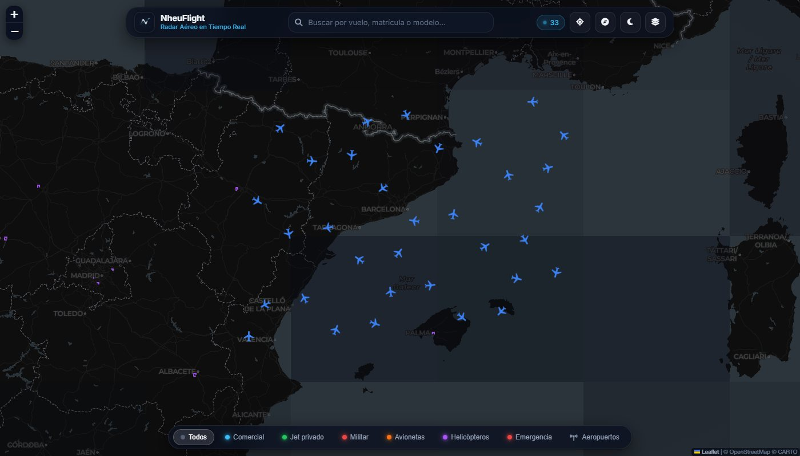
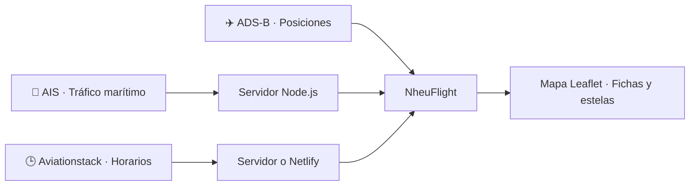

<h1 align="center">NheuFlight</h1>

<strong>Radar aéreo y marítimo en un mapa interactivo</strong>

*Captura de la interfaz con aeronaves de ejemplo.*

## Qué puedes explorar

| | En el mapa | Al seleccionar |
| :---: | --- | --- |
| ✈️ | **Aeronaves** · Busca por indicativo o matrícula y filtra por tipo. | Altitud, velocidad, rumbo, estela y horarios cuando hay datos. |
| 🚢 | **Barcos** · Sigue el tráfico AIS o abre el [radar marítimo independiente](nheu-marine/). | Nombre, MMSI, velocidad, rumbo y destino recibido. |
| 🌦️ | **Aeropuertos y tiempo** · Activa aeropuertos, pistas, corredores y lluvia. | Vuelos asociados, meteorología METAR y pronóstico TAF. |
| 🌍 | **OSIRIS** · Explora puertos estratégicos, terremotos, incendios y satélites. | Cámaras públicas y emisiones informativas disponibles. |

**Favoritos y alertas** para guardar vuelos · **Modo demo** para simular aeronaves · **Monitores DGT** para [avisos por Telegram](no-hosting/README-DGT-MONITOR.md)

## De los datos al mapa

Los horarios se muestran como **reales**, **programados** o **estimados** según los datos disponibles. Si faltan datos para calcularlos, se muestra `—`. La interfaz se puede volver a abrir sin conexión tras una carga previa.

<strong>Explorar el código</strong>

| Archivo o carpeta | Qué contiene |
| --- | --- |
| [app.js](app.js) y [classify.js](classify.js) | Radar aéreo, fichas, búsqueda y clasificación |
| [marine-tracker.js](marine-tracker.js) y [nheu-marine](nheu-marine/) | Radar marítimo integrado e independiente |
| [osiris.js](osiris.js) y [data](data/) | Capas de contexto y catálogos |
| [server.js](server.js) y [netlify](netlify/) | Conexión con proveedores y manejo de claves en el servidor |

## Créditos

Las capas de contexto se basan en [OSIRIS, de simplifaisoul](https://github.com/simplifaisoul/osiris). El código original se puede usar, modificar y redistribuir bajo la [licencia MIT de OSIRIS](LICENSE-OSIRIS.txt), conservando el aviso de copyright y licencia.

## Cómo ejecutarlo

<strong>Ver instalación, claves y despliegue</strong>

Con Node.js 22 o posterior, ejecuta `node server.js` y abre [localhost:8080](http://localhost:8080). En Windows también puedes usar `iniciar.bat`. Para el radar marítimo independiente, ejecuta `node nheu-marine/server.js` y abre [localhost:8085](http://localhost:8085).

| Servicio | Variable de entorno |
| --- | --- |
| Mapas CARTO | `CARTO_API_KEY` |
| Horarios | `AVIATIONSTACK_API_KEY` |
| Barcos en directo | `AIS_KEY` |
| Alertas DGT | `TELEGRAM_BOT_TOKEN` y `TELEGRAM_CHAT_ID` |

- **En local.** Para el servidor, usa variables de entorno o un archivo `.env` fuera del repositorio con una asignación `NOMBRE=valor` por línea. Ruta predeterminada en Windows: `%LOCALAPPDATA%/NheuFlight/.env`. En macOS y Linux: `~/.config/NheuFlight/.env`. Puedes indicar otra ruta con `NHEU_SECRETS_FILE`.
- **En Netlify.** Configura CARTO y Aviationstack con alcance de Functions y vuelve a desplegar. Para AIS, configura la URL HTTPS de un servidor Node persistente en `window.NHEU_MARINE_BACKEND_API` dentro de `app-config.js`.
- **Alertas DGT.** Configura las variables de Telegram en el entorno del monitor o en los secretos de GitHub Actions.

Sin CARTO se usa Esri. Sin Aviationstack, el radar estima los horarios cuando dispone de datos suficientes.

